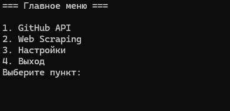
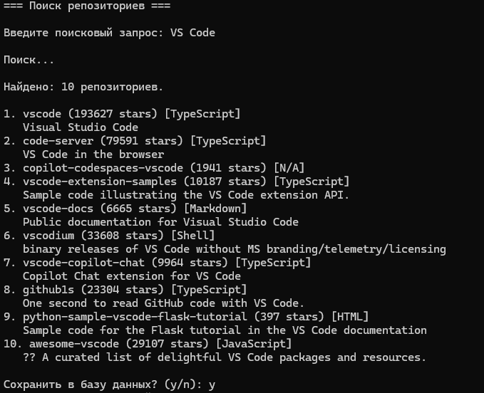

# GitHub API & Web Scraper Console App


Консольное приложение на C# для взаимодействия с **GitHub REST API** и **веб-скраппинга** с сохранением результатов в локальные базы данных. Проект демонстрирует работу с REST API, парсинг HTML, Entity Framework Core, LiteDB и построение чистого консольного интерфейса.

---

## Скриншоты

### Главное меню



### Поиск репозиториев через GitHub API



---

## Возможности

### 🔹 GitHub API
- Поиск репозиториев по ключевым словам через официальный GitHub API.
- Просмотр детальной информации: количество звёзд, язык программирования, описание, владелец, дата создания.
- Сохранение найденных репозиториев в реляционную БД (SQLite через EF Core).
- Просмотр сохранённых репозиториев с сортировкой по звёздам.
- Открытие репозитория в браузере прямо из консоли.

### 🔹 Web Scraper
- Извлечение данных с произвольных веб-страниц:
  - `<title>` — заголовок страницы;
  - `<h1>` — главный заголовок;
  - `<meta name="description">` — мета-описание;
  - `<a href="...">` — все ссылки на странице;
  - первый параграф текста (предпросмотр).
- Сохранение результатов в документную БД (LiteDB).
- Просмотр истории скраппинга с фильтрацией по дате.

### 🔹 Настройки
- Гибкая конфигурация через файл `settings.json`.
- Настройка имён файлов баз данных, количества результатов поиска и таймаута HTTP-запросов.
- Сброс настроек к значениям по умолчанию.

---

## Технологии

| Категория | Технологии |
|-----------|-----------|
| **Язык** | C# 11, .NET 6/7/8 |
| **API** | GitHub REST API v3 |
| **Базы данных** | SQLite (EF Core), LiteDB |
| **Парсинг** | HtmlAgilityPack |
| **Сериализация** | System.Text.Json |
| **HTTP** | HttpClient |

---

## Структура проекта

```text
InternetTechLab1/
├── Database/                           # Слой доступа к данным
│   ├── GitHubReposDb.cs                 # DbContext для SQLite (EF Core)
│   └── ScrapingDb.cs                    # Обёртка над LiteDB
│
├── Models/                             # Модели данных
│   ├── GitHubRepository.cs              # Модель GitHub-репозитория
│   ├── ScrapedPage.cs                   # Модель спарсенной страницы
│   └── Setting.cs                       # Модель настроек приложения
│
├── Services/                           # Бизнес-логика
│   ├── GitHubService.cs                 # Клиент GitHub REST API
│   ├── WebScraper.cs                    # Логика веб-скраппинга
│   └── SettingsService.cs               # Чтение/запись settings.json
│
├── UI/                                 # Консольный интерфейс
│   ├── ConsoleHelper.cs                 # Вспомогательные методы
│   ├── MainMenu.cs                      # Главное меню
│   ├── GitHubMenu.cs                    # Меню работы с GitHub API
│   ├── ScraperMenu.cs                   # Меню веб-скраппинга
│   └── SettingsMenu.cs                  # Меню настроек
│
├── docs/                               # Скриншоты для README
│   ├── main-menu.png
│   └── github-search.png
│
├── Program.cs                          # Точка входа (bootstrap, ~30 строк)
├── settings.json                       # Файл конфигурации
├── LICENSE                             # MIT License
└── README.md
```

### Архитектура

Проект построен по принципу разделения ответственности (Separation of Concerns):

```
┌──────────────┐     ┌──────────────┐     ┌──────────────┐
│      UI      │ ──► │   Services   │ ──► │   Database   │
│  (Console)   │     │ (API, Scrape)│     │ (EF, LiteDB) │
└──────────────┘     └──────────────┘     └──────────────┘
```

- **UI** отвечает только за взаимодействие с пользователем.
- **Services** содержит бизнес-логику и не знает о консоли.
- **Database** инкапсулирует работу с хранилищами.

---

## Установка и запуск

### Требования
- [.NET SDK 6.0+](https://dotnet.microsoft.com/download)
- Git

### Пошагово

1. **Клонируйте репозиторий:**

   ```bash
   git clone https://github.com/Demonrux/InternetTechLab1.git
   cd InternetTechLab1
   ```

2. **Восстановите зависимости:**

   ```bash
   dotnet restore
   ```

3. **Запустите приложение:**

   ```bash
   dotnet run
   ```

При первом запуске автоматически создадутся `settings.json` и файлы баз данных.

---

## Конфигурация

Файл `settings.json` создаётся автоматически при первом запуске:

```json
{
  "gitHubReposDatabase": "gitHubRepos.db",
  "scrapingDatabase": "scraping_docs.db",
  "count_page": 15,
  "timeout": 30
}
```

| Параметр | Описание | По умолчанию |
|----------|----------|--------------|
| `gitHubReposDatabase` | Имя файла БД для репозиториев | `gitHubRepos.db` |
| `scrapingDatabase` | Имя файла БД для скраппинга | `scraping_docs.db` |
| `count_page` | Кол-во результатов поиска (1–100) | `15` |
| `timeout` | Таймаут HTTP-запросов (сек) | `30` |

Все параметры можно менять как напрямую в файле, так и через пункт **«Настройки»** в меню приложения.

---

## Использование

### Главное меню

```text
=== Главное меню ===
1. GitHub API
2. Web Scraping
3. Настройки
4. Выход
```

### Пример: поиск репозиториев

```text
=== Поиск репозиториев ===
Введите поисковый запрос: C++

Поиск...

Найдено: 10 репозиториев.

1. tensorflow (185000 stars) [C++]
   An Open Source Machine Learning Framework for Everyone
2. electron (115000 stars) [C++]
   Build cross-platform desktop apps with JavaScript, HTML, and CSS
...

Сохранить в базу данных? (y/n):
```

### Пример: скраппинг страницы

```text
=== Скрапинг URL ===
Введите URL: https://example.com

=== Результат ===
Заголовок: Example Domain
H1:        Example Domain
Описание:  Example Domain for use in illustrative examples
Ссылок:    1

Текст:
This domain is for use in illustrative examples in documents...

Сохранить в БД? (y/n):
```

---

## Лицензия

Этот проект распространяется под лицензией **MIT**. Подробности см. в файле [LICENSE](LICENSE).

---

## Автор

**Дмитрий Ананьев**
- GitHub: [@Demonrux](https://github.com/Demonrux)
- Email: demonrux201@gmail.com
- Telegram: [@skebob_gg](https://t.me/skebob_gg)
